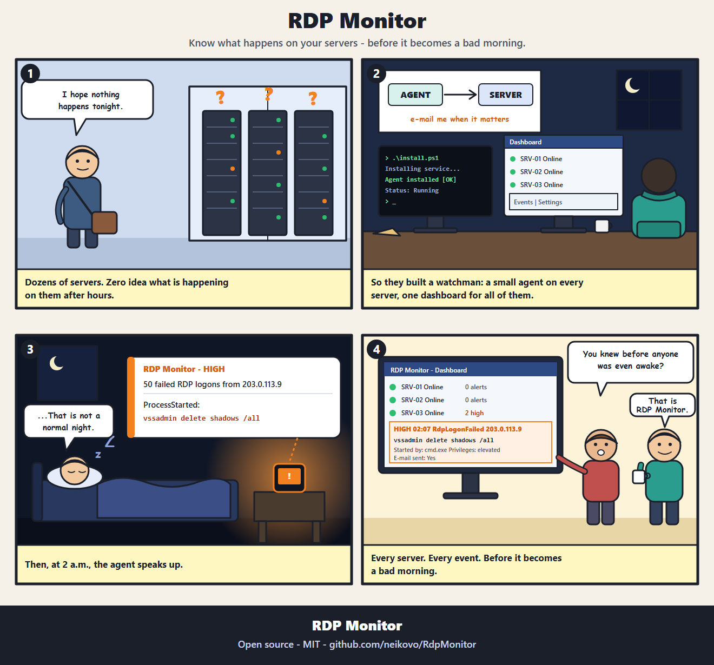

# RDP Monitor

An agent/server system that monitors RDP sessions and suspicious processes on Windows Server 2022 and newer.

- **Agent** - a Windows service on every monitored server: detects RDP events and suspicious process starts and reports them to the central server. (A file audit is prepared but needs the Windows file-audit policy to be enabled.)
- **Server** - central: receives the data, stores it (SQLite), sends e-mail alerts by priority and serves a web dashboard.

**Installation and operation: see [INSTALL.md](INSTALL.md).**



## Features

- RDP logon, logoff, disconnect, reconnect and **failed logons** (with and without NLA), with source IP
- **Suspicious process** audit: configurable list of programs and command-line regex patterns; each record shows the program, command line, why it was flagged, the parent process, PID and privileges
- Priority per event type, global e-mail threshold, per-agent mute, multiple recipients
- **Ignored source addresses** (an IP or a CIDR network, e.g. your admin jump server): events from them are not recorded; failed logons are still reported unless you say otherwise
- **Export** the events (with the current filters) to CSV
- **Automatic cleanup** of old events (7 days by default; set in the dashboard, 0 = keep forever)
- Web dashboard: agents online/offline, events with filters, settings; safe deletion (events need the admin password, an agent needs its name typed)
- The agent keeps events in a local queue until the server accepts them, so nothing is lost during an outage
- Agent connects outbound only (HTTPS, API key per agent); no inbound ports on monitored servers
- **Hardened by default:** the server refuses the shipped placeholder password/token, agents can pin the server certificate, guessing is rate-limited, secrets and the database are in files only administrators can read, and passwords on command lines are masked (see [INSTALL.md](INSTALL.md), section 10)

## Packages

**Ready-made packages:** download them from [Releases](https://github.com/neikovo/RdpMonitor/releases/latest) (unsigned - see the notes there; checksums are in `SHA256SUMS.txt`).

Or build them yourself with `.\publish.ps1` (requires the .NET 8 SDK). It creates in `dist\`:

- `RdpMonitor.Server.zip`
- `RdpMonitor.Agent.zip`
- `INSTALL.md`

## Code layout

```
src/RdpMonitor.Shared   shared types (events, priorities, DTOs)
src/RdpMonitor.Agent    Windows service: RdpSessionMonitor, AuditMonitor/AuditParser, ServerApiClient, LocalEventQueue
src/RdpMonitor.Server   ASP.NET Core: agent API, Razor Pages dashboard, AlertService, EmailService, SQLite
deploy/update.ps1       update script (copied into every package)
```

## Responsible use

This tool watches logons, processes (and optionally files) on servers. Use it only on systems you manage or have explicit permission to monitor, and in line with your internal policies and data-protection law. It is provided "as is", without warranty (see [LICENSE](LICENSE)). Before real use, change the default passwords and token (`CHANGE-ME...`) - see [INSTALL.md](INSTALL.md).

## Security

Found a vulnerability? Please report it privately - see [SECURITY.md](SECURITY.md).

## License

MIT - see [LICENSE](LICENSE).
